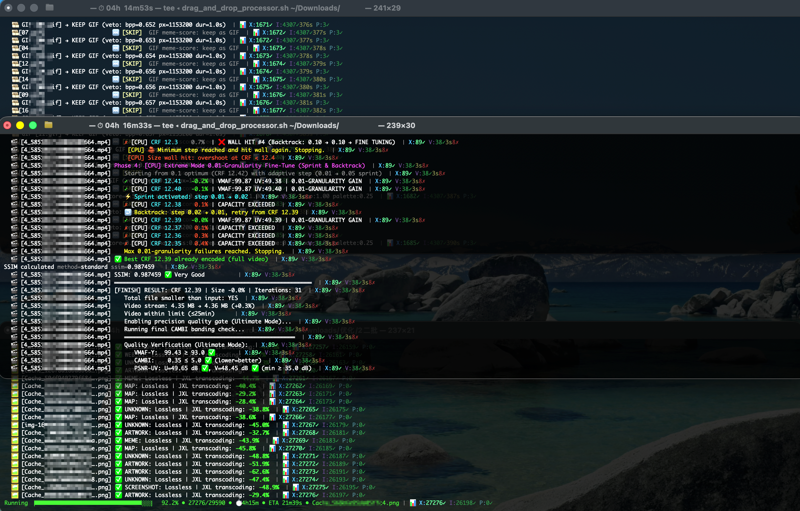

# Modern Format Boost


-E57324?style=for-the-badge&logo=rust&logoColor=white>)


**以证据驱动媒体焕新：保留源语义、核验最终交付、无法证明时失败关闭。**

[English](../README.md) · [简体中文](README_ZH.md)

## 近期两轮更新：配置、交付可靠性与验证效率

本节汇总 2026-10-01 至 2026-10-04 的相册、计数、日志、界面与 CI 改进。
逐项记录见 [更新日志](CHANGELOG.md)，完整参数见 [运行配置](dev/config/RUNTIME_CONFIG.md)。

### 计数与结果怎么读

本轮审计修正了跳过误计为成功、实时统计漏记恢复项目、不完整扫描误判通过，以及重复图库回执
抬高已验证数量等问题。普通批次会核对：

```text
已处理 = 成功 + 失败 + 跳过 + 忽略
本次发现的候选项目 = 已处理 + 未处理
```

| 结果 | 含义 |
| --- | --- |
| 成功 | 已通过当前处理路径要求的交付验证，不仅是编码器退出成功。 |
| 失败 | 已确认的文件级错误；保留源文件，是否继续由失败策略决定。 |
| 跳过 | 按策略不转换，或复用当前候选文件的有效恢复记录；不算新的转换成功。 |
| 忽略 | 不属于当前处理器的范围；不表示已交付，也不表示文件丢失。 |
| 未处理 | 尚未得到最终结果，包括提前停止的项目，以及要求图库交付但尚无验证回执的输出。 |

实时计数在保留源文件所需的复制成功后才确认跳过；提前终止不会强行显示 100% 进度。
完整性问题和收尾错误单独报告，不再凭警告数量虚构“失败文件”。没有实际成功或失败的转换时，
转换成功率显示为不可用，而不是 100%；跳过、忽略和未处理不参与该比率。

还需要区分统计范围：IMG/VID 汇总是各处理器的项目结果之和，不一定等于文件夹的唯一文件数
或图库的唯一资产数。转换前后字节数只统计本次成功转换，不包含跳过、恢复复用和附带文件复制。
数量相等只是数量证据；文件身份、内容、元数据和图库原件仍须通过各自的验证。
详细约定见 [计数规则](hardening/COUNTING_CONTRACT.md)。

元数据检查失败与单文件编码失败也要区分：例如 319 张图已编码，但一项必需的交付检查失败时，
可以出现“编码 319、成功交付 0、单文件失败 0、未处理 319”。这不是全部编码失败，也不是
成功完成；批次仍以错误状态结束，导入和清理被阻止，源文件与工作副本保留。

JPEG 的厂商信息可能位于头部 APP 数据段、注释段或尾部，例如三星的 SEFT 截图信息。
缺少直接显示的字段不再仅凭字段名决定是否放行：先核对工具报告的实际存储位置与原字段值，
再从当前 JXL 重建出与原文件逐字节一致的完整 JPEG，才能确认这些 JPEG 专有信息仍被保留。
原生 EXIF/XMP/ICC、EXIF 内的厂商附加信息及外部 XMP 覆盖仍须满足各自检查要求；
没有重建数据、配错源文件、位置不明或字段值冲突都会被拒绝，不会把未知字段一概忽略。
同名字段的多份记录也会分别核对，读取不完整或工具报错不能被当作“没有元数据”。
`Copy1/Copy2` 只是 ExifTool 本次读取时分配的编号；跨格式核对实际位置、字段名、值和份数，
不会因编号变化误报，也不会把丢失的一份重复字段忽略掉。可逆 JPEG 归档分别核验原生 XMP、
保存在 JPEG 重建数据中的其他 XMP 包，以及当前外部 sidecar，避免把追加层误当成覆盖写入。
源文件已有的 MakerNotes 无法识别或 UserComment 编码告警，只有完整 EXIF 载荷保持逐字节
一致才可继续；告警仍会记录，新告警、读取不完整或载荷变化仍会阻止交付。
JPEG 的 XMP 探测遵循数据段边界，包括渐进式图像的扫描间元数据；其他数据块内部或
图像结束后的相似字节不会被误认成正式 XMP。

### 界面和日志更明确

设置面板随当前分页的可见选项调整高度，减少固定大面板的空白；主窗口的路径、模式控件
按可用宽度对齐，缩小过大的标题和留白。“仅预览”和“导入到照片”并排靠左，切换处理模式时
收起没有可见选项的空列，避免导入选项孤立在窗口中间。照片高级选项只在对应分页显示。

主窗口的“处理记录”直接查看近期批次，支持搜索和筛选“需关注”的记录。选择一批即可查看
成功、跳过、失败、忽略、未处理数量，源目录、输出路径，以及验证器实际记录的
`MATCH`（数量匹配）、`EXPLAINED`（差异已有说明）或 `MISMATCH`（不匹配），也能直接打开
对应日志。处理结果计数不等同于唯一源文件数或照片资产数，数量匹配也不等同于全部处理成功。
旧记录、缺失计数和未确认结束的批次明确显示“未知”或“不完整”，不会用零补齐；归档完成
不代表处理成功。此工具只读日志，不扫描或操作图库，默认读取 `~/.modern_format_boost/logs`，
并记住后端实际使用的日志路径。清空实时日志视图不会删除历史记录。

JPEG 还原批次显示“还原 JPEG”和实际输出路径，包括处理前失败时已确定的目标路径。
核验清单按已还原 JPEG 展示，不再套用优化处理的节省空间统计；未记录核验仍显示未知，
不会编造数量匹配。启动器明确拒绝一次还原多个输入，避免只处理首个目录却记录整批输入。
目录核验回执必须对应本批记录的源和输出路径；相对命令行路径统一记录为绝对路径，
读取历史时不依赖文件仍存在。Photos 审计没有目录回执时仍保留未知，不冒充数量匹配。

标准模式实际处理多个输入时，先为全部输入确定输出并完成扫描，再启动处理程序，避免只处理
第一个目录。重复或互相嵌套的输入、覆盖源目录的输出会明确拒绝；原地处理会锁住全部输入。
未指定输出时，各输入使用自己的相邻输出；指定统一输出根目录时，使用 `001_Album`、
`002_Album` 这样的编号子目录，避免同名输入混在一起。历史记录保存逐输入的真实源/输出
对应关系和目录核验结果。缺失、矛盾或溢出的证据不会变成整批 `MATCH`；目录与单文件混合
时，保留各目录的核验，但不替单文件编造统一数量清单。处理程序失败后仍停止整批后置交付，
不会据其他文件成功就继续交付；多输入监视模式暂不支持，会明确报错。
预演仅记录计划，不扫描媒体，也不产生处理或核验计数。
需要按真实内容查看逐文件预检清单时，可使用
`drag_and_drop_processor --mode auto --plan-json /path/to/input`；也支持 `images`、
`videos` 和多个输入。带版本的 JSON 列出每个可见普通文件的相对路径、处理归属、是否
选中、字节数、计划动作及原因，同时记录已选定的输出路径。它在创建会话、数据库、锁、
输出目录或启动处理程序之前返回；不会执行转换、导入或源文件清理。XMP 不算独立媒体
任务，非媒体文件的复制明确以相邻目录处理成功为前提；清单不完整或目标不安全时直接报错，
不返回部分清单冒充完整结果。这是路由快照，不预测编码质量、耗时或临时空间，也不是
持久执行计划、恢复检查点或交付证明。Fast 和管理模式暂不适用；它与只展示命令的
`--dry-run` 是两种不同的检查。
预检还显示目标磁盘当前可用空间，查询已确定输出的最近现存目录，不创建输出目录。
单文件未确定输出或查询失败时明确显示未知和原因，不编造成零。这是当时的磁盘快照，
不是空间预留、临时文件需求预测或“本批一定能放下”的保证。

Developer 的“工具路径”可分别编辑 IMG、Fast IMG、VID，支持原生文件选择、继承单项或
重置当前类型；不改写配置文件。刷新预览可查看实际配置路径和来源，不代表工具已执行
或能力已核验。IMG/VID 共用可重复的 `--tool NAME=/absolute/path`；启动器分别使用
`--img-tool`、`--vid-tool`，不适用的类型会报错。路径中的空格和等号原样保留，非法名称、
相对路径、空字节或无法无损传递的路径会明确拒绝。
日常处理选项归入图片、视频页面。**私人策略决定怎么归档，设置只调整策略允许的参数。**
第一次使用可保持“按归档规则”，无需先理解 D/E 或自行选择档位。

| 图片设置 | 含义 |
|---|---|
| 画质参数（D） | 0 表示无损，数值越大允许的失真越多。只作用于允许调整画质的来源，不会让无损 PNG 变成有损，也不会改变 JPEG 可逆转码。 |
| 自动选择画质（D） | 在适用来源上寻找符合体积要求的更高画质；开启后保留手动 D，但暂不使用它。默认“按归档规则”仍保留原有的条件搜索。 |
| 压缩档位（E） | 调整编码工作量，不是画质等级。固定时使用所选档位，较高档位不保证文件更小。 |
| 比较压缩档位（E） | 多次编码并核验，选择较小的结果，可能更耗时。“比较至档位”表示允许比较到这一档，不承诺最终使用它。 |
| JPEG 无损转码档位（E） | 独立调整 JPEG 可逆转码；即使比较多个档位，每个候选也须能逐字节恢复原 JPEG。 |

自动画质与档位比较可以分别开关；同时开启时先比较 E，再以选中的 E 搜索 D。Fast JXL 只显示适用的
JPEG 转码选项，Fast AVIF 使用独立的画质选择；Q100 是编码器的最高质量设置，不等于所有输入
都保证数学无损。数值、范围和实际默认值的技术说明如下。

普通 IMG 的 D 表示像素失真距离，E 表示编码努力程度；两者数值与探索状态独立。
不指定覆盖时保留原有模式规则：Normal E7、Ultimate/archive E10、PNG E10、JPEG 转码 E11。
PNG 等无损来源的 D0 由私人策略保证，并不是靠设置默认值才成立。现代有损媒体仍按原有
策略保留原编码；严格验证的单帧静态视频容器仍属于 IMG。
D 探索复用既有 D0 基线、阶梯筛选、二分和精化，并始终在同一选定 E 域内完成。
E 探索默认关闭；开启后比较同质量下已验证的纯媒体载荷，体积相同优先较低 E。
同时开启时先选 E 再搜索 D，不是二维全域最优搜索，也不是“低 E 辅助高 E”的加速算法。
Fast JXL 只提供 JPEG E 及可验证的 E 比较，不显示普通像素 D；Fast AVIF 保留独立的 Q／Speed
搜索与最终编码核验，不将 JXL 参数机械套用到 AVIF。各模式既有元数据政策保持分开。
图片工具选择和长视频完整质量校验归入各自处理页面；失败策略、配置文件和诊断仍在开发者区。
`--jxl-distance`、`--jxl-effort`、`--jxl-effort-search`、`--quality-search` 输入同一份 typed 配置，
启动器使用对应的 `--img-` 前缀。继承或重置只移除 GUI 覆盖，不改写 JSON；不适用的
显式参数会拒绝，不静默忽略。已有 CLI 模式接口保留，合法显式参数通过同一解析器覆盖，
不形成独立 GUI 策略。算法基准及适用范围见 [私人 IMG 策略](dev/config/IMG_PRIVATE_POLICY.md)
和[运行配置](dev/config/RUNTIME_CONFIG.md)。
直接指定标准 `images/videos` 模式与对应筛选开关使用相同范围；图片模式不会再把视频算作
选中媒体。目录的相邻输出不能与源目录相同、包含源目录或位于源目录内部；链接别名也会
先解析再核对，不通过创建输出目录来试探。
标准预扫描会纳入合法链接目录中的文件；先检查链接目标，再进入目录。
循环、断开的链接或危险目标会明确报告清单不完整，阻止处理启动。
Fast 模式的链接规则不变。标准 IMG 的处理队列现在保留扫描时的文件大小和修改时间，
Unix 还保留设备、文件编号和变更时间；真正转换或按恢复记录跳过前再次核对。
Fast IMG 则在编码或确认“无需编码”前核对计划中的源文件 BLAKE3。文件变化、被替换或
无法读取时，拒绝该项、保留源文件并记为失败，不悄悄算作跳过。
标准路径的元数据身份不是内容哈希，非 Unix 平台的证据较弱；这只是处理队列的准入检查，
不是完整的统一预检或启动器跨进程清单绑定，最终产物核验仍须执行。
标准启动器也会保留自己扫描到的源文件身份与链接解析目标：分类期间核对一次，真正启动
处理程序前再核对相关文件。文件变化、被替换、缺失或链接改向时拒绝启动并保留源文件，
不会把没有结果回执的任务猜成失败数或跳过数。启动请求、配置捕获、输出收集与结束错误
现由共享 application 执行模块管理，不再依附于交互菜单；GUI 仍使用相同启动入口。
启动前检查不是内容哈希，也没有完成跨进程清单协议，因此仍不能通过重新扫描整个目录
直接替换逐文件调用；反复启动处理程序的开销尚未在本轮消除。

标准 IMG 的图片设置提供“允许体积增加”和“增加上限（字节）”，分别对应
`img.allow_size_tolerance`（默认关闭）与 `img.size_tolerance_bytes`（默认 524288 字节，即 512 KiB）。
`img run --allow-size-tolerance --size-tolerance-bytes 4096` 请求最多增加 4096 字节的媒体本体，
单独修改上限不会自动开启；`=false` 或 `--no-allow-size-tolerance` 可覆盖已保存的许可。
元数据不占额度，严格大小策略仍可禁止增加，所有安全核验保持。开启时上限设为 0，
允许等大但不允许增加；关闭或严格大小策略仍要求结果更小。生效配置与历史分别保存
开关、额度及来源，日志报告请求和实际采用的字节额度；启动器参数为 `--img-size-tolerance-bytes`。
不改变 Fast IMG 或 VID，向不适用的模式明确传参会被拒绝。Photos 复选框的说明与勾选框放在一起，缩窄设置面板，
继承值加载和重置后也不会丢失标题。

同一次 JPEG 元数据核验中，多层 XMP 和 JPEG 专属字段需要相同的完整重建证明时，
只生成一次证明；复用前重新计算当前源文件与输出的哈希，变化就拒绝复用。原生元数据、
侧车和字段矛盾仍分别检查。这减少该路径的重复解码，不删除安全门禁，也不跨核验缓存
证据；没有据此宣称整批处理快了多少。

主窗口日志下方单独显示最近错误和最近警告。具体错误不会被结束汇总或退出码提示覆盖，
下一批开始时清空；普通 stderr 输出不再仅因为来自错误通道就标为失败。这些提示只影响
显示，不改变处理结果计数，完整输出仍可在历史记录中查看。

实时日志按后端明确报告的阶段展示：处理文件后进入验证与交付，Gate 1-3 合并显示，
短阶段不会连续清屏。阶段切换只替换显示内容，错误、警告和结果计数仍保留，完整处理
输出继续存入 SQLite 历史。无法识别阶段时保留当前视图并提示，不根据普通日志猜测阶段。
进入验证后隐藏上一阶段的文件进度，不把编码结束误当成全部验证完成。

开发者模式下，设置项旁的信息按钮可预览实际生效值，以及默认值、环境变量、配置文件、
命令行和 GUI 覆盖的实际参与顺序。IMG 与 VID 的性能配置独立查询，不混成同一个值。
预览不会保存设置或启动媒体任务；普通模式不增加这些开发信息。CLI 的
`config show --effective` 同步提供有序的 `source_chain` 与最终 `sources`，相同值的显式
覆盖也会保留。历史配置快照仍记录最终来源，不把本次预览链冒充为旧批次的完整覆盖链。

历史详情顶部显示 Fast IMG 和普通 IMG/VID 批次当次新转换文件的体积变化，包括输入、输出的精确字节数，
区分减少、增加和不变；跳过、失败、复用文件不计入，仅恢复旧进度也不冒充本次收益。
缺少可比数据时明确显示未记录，体积记录损坏不抹掉有效处理计数或失败结果。

普通 IMG/VID 的批处理报告只汇总本次成功转换项。输出大小缺失或字节总量溢出时，
对应总量和体积变化明确显示未知，不用输入大小代替输出，也不把不完整输出总量当作
节省空间。普通 IMG/VID 现在通过结构化整数记录保存至历史数据库，多次处理调用按检查溢出的加法汇总。
任一参与调用未提供测量时，总量继续保持未知；未提供记录的单文件处理和旧批次仍显示未记录。
损坏或冲突的体积记录单独提示，成功、失败和跳过计数保持原义。
这里显示文件体积差，不代表保留原件时磁盘空间已经释放。

标准 IMG/VID 批处理与 Fast IMG 编码现在显示当前阶段的文件进度：已处理数、总数和
两位小数的百分比。它不是耗时预测，也不代表整批完成；失败、跳过同样属于已处理，
核验和交付仍可能继续。Fast IMG 仅统计本次待处理任务，在一批结果写入检查点后更新，
不把恢复时复用的旧输出算入分母。没有可靠总数的步骤保持不确定状态，提前结束不会补成 100%。

Gate 1 核验期间，主窗口改为显示最新明确上报的检查项：数量、大小、BLAKE3、元数据、
方向或解码。准备清单时为 0 项；已返回结果的检查数包含失败项，失败后剩余检查明确显示
未执行。六项通过仅表示这一次本地 Gate 通过，不表示整批或 Photos 交付完成。
“收到更新于多久前”只描述界面收到最新消息的时间，不推断超时、剩余耗时，也不编造
整批百分比。完整事件保留在历史中；回到处理阶段或任务结束会清除当前活动，结果计数不变。

新批次的目录信息、计数、核验结果和结束状态统一保存到日志目录内的 `history.sqlite3`，
与可清理的分析缓存分开。历史窗口只读查询近期批次，并限制读取条数和大小；旧 JSONL
历史仍可查看，不会自动改写。相同批次以数据库记录为准，避免归档副本重复计数。
启动器捕获的处理输出现按批量写入同一数据库，不再重复写进会话和 verbose 文本日志。
选中批次后点“查看处理输出”，从最新一页开始查看，可向前、向后翻页，也可切回“概览”。
每页最多 1,000 条、2 MiB；显示的记录范围和总数属于打开时的输出快照，不是文件数量。
“异常分组”按本页的管线、明确记录的阶段、严重程度和完整消息合并重复日志，显示出现
次数、重复次数及首末记录序号。不同路径或数字不会混为一组；阶段未记录时显示未知，
不沿用其他页的阶段。这里统计日志条数，不是失败文件数或整批错误数；“全部”仍保留每条原始记录。
超大或损坏记录会明确标出，仍可继续翻页；刷新后可查看快照之后新增的输出。
同一会话内多次处理有独立的输出边界，不会串日志；这些记录不代替成功或失败的结构化计数。
新启动器批次还具有独立的运行标识，包括同一会话内的再次处理。事件、处理程序启动请求和
当时配置绑定到该标识；已标识批次中缺少或冲突的标识会使记录不完整。旧记录仍明确未知，
不拿文件名补写。运行标识不等于逐文件任务身份、崩溃恢复或实际执行程序的证明。
“失败文件”页增加已记录原因，并可按路径或原因筛选。结构化记录保存准确上报的路径、
可用时的绝对路径、完整原因和明确的原因码，且核对所选运行与处理调用。相同记录合并显示，
同一文件的不同原因分别保留；记录条数不等于最终失败文件数，也不代表相同根因。旧路径
没有对应原因时明确显示“未记录”，不从普通日志猜测。读取遵循整批异常扫描的边界、时限和
容量限制；损坏、超大或串批次记录明确报错，不显示为零。表格最多 1,000 行、2 MiB；
悬浮提示和无障碍标签保留完整原因。复制保留原始上报路径，定位优先使用已记录的绝对路径；
缺失文件及末级链接不打开。诊断 JSON 保留每条原始失败观察、运行标识及独立条数，不冒充
完整 Manifest 或“已记录所有失败”的证明。
诊断导出 schema 2 将界面记录标识 `history_entry_id` 与实际记录的 `run_id` 分开；旧批次
没有运行标识时导出 `null`，不拿界面索引冒充运行身份。History 数据库 schema 不变。
历史写入端关闭连接后保留 SQLite 管理的 WAL／共享内存文件，避免系统 SQLite 无法只读
打开冷 WAL 库。完整同步写入和检查点不关闭；历史窗口仍只读，不使用忽略并发 WAL 的
immutable 模式，不自动修复或清空数据库。已有冷库缺少辅助文件时仍明确报错，之后正常、
经过校验的写连接负责管理其辅助文件，不由 GUI 暗中改成写连接。
同时选中两个批次后，可在原有详情页打开“原因对照”。按已记录路径、可用的绝对路径、
管线、原因和原因码完全一致分组，列出两个快照共有和各自独有的记录及出现次数，显示
对应批次／运行标识和输出边界。复用有界只读扫描；切换选择会取消，损坏、无法读取或
超限时不显示部分对照。相同记录不证明文件内容或根因相同，未记录也不证明成功或已修复。
这里不是跨运行错误指纹系统，记录次数不代替失败文件数。
主窗口只折叠连续、完全相同的警告或错误，并注明同一日志出现次数。不同文件、数字、
中间普通日志、阶段更新或新批次都会打断折叠。具体错误和结果／进度仍按原始消息更新，
SQLite 历史不删记录、不改文件计数。普通界面将文件失败记录显示为可读原因，Developer
另保留原始 JSON。
新增的“异常”页读取所选批次全部已存输出，不受当前输出分页限制，并将阶段信息带入后续页。
按管线、明确阶段、严重程度和完整消息分组，保留路径、具体数值及首次／最后原始记录。
次数只指日志记录，不代表失败文件数或相同根因。尚未结束的批次标为当前快照；读取超过
100,000 条／64 MiB、4,096 组／2 MiB 分组内容或 15 秒限制，或证据损坏、边界冲突时，
明确显示无法汇总，不展示部分统计或伪造零异常。改变选择、刷新和关窗会取消实际读取，
原始输出和处理结果不变。
历史窗口的导出按钮可将所选批次保存为带版本的诊断 JSON。它从同一个只读 SQLite 快照
重新读取该批次的配置、结果计数、验证和终态，保留警告、错误、明确阶段与 Gate 活动记录的原文，
以及已记录的处理程序启动请求和对应配置。活动记录与阶段、异常记录分别计数，
并列明保留、主动省略的普通日志条数；未知值保持 `null`。这不是恢复检查点或完整 Run Manifest。
关键证据损坏或超过限制时拒绝导出；关窗、改变选择后不再发布。已有文件、链接及 Git 工作区
不会作为导出目标。诊断可能包含私人路径，只在本地按用户选择保存。
详情同时记录当时的版本和显式重试、继续运行请求。
历史数据库 v1 会事务迁移到 v2，保留旧记录；未知版本或写入失败明确报错，不会自动清空重建。
新批次还会直接保存 IMG/VID 处理端解析出的运行时 JSON、各字段最终值来源和处理端版本。
历史详情显示当时的快照，不按今天的设置重新推测；相同配置只合并显示，处理端启动次数
仍单独统计，不混入文件计数。旧批次明确显示“未记录”，无效或未来版本记录明确报错。
新启动请求还记录原始程序名、完整参数数组、调用 ID，以及启动前观察到的程序路径、
字节大小和 BLAKE3；历史详情将当时生效配置绑定到对应调用。无法读取程序证据时保留未知
并说明原因，不拿今天的程序补写旧记录。`launch_requested` 表示请求启动，不证明实际执行的
进程、加载的二进制、PID 或构建来源，也不冒充完整 Run Manifest。
选择两批记录时，分别比较 IMG/VID 当时的配置值和最终来源，不再只显示版本号。
两侧都只有一份可信的不同配置快照时才能比较；缺失、损坏、多套配置或记录不完整时
明确提示无法对比。没有记录的字段不补默认值；配置相同不表示文件、外部工具和环境相同，
也不会据此判断处理结果变化的原因。
这些快照覆盖 `RuntimeConfig` 的字段，不等于全部命令参数、完整覆盖链、工具版本或回退后
最终选用的后端。归档目录改为处理文件夹名称前缀，例如 `Photos_Bundle_<会话>`；名称过长
会安全截短，重名时另建编号目录，不覆盖原归档。旧归档仍可查看。
内部 tracing、管线审计文件和恢复检查点仍未全部迁入，这一步不代表整个日志与恢复系统已经完成迁移。

目录扫描快照统一在本地 SQLite 中读取、保存和清理，不再先连接 PostgreSQL，也不再双写备用库。
进程内的工具健康缓存现在核对实际可执行文件的元数据身份，包括解析后的目标路径和 Unix
设备／inode／状态变更时间。同大小、保留修改时间的替换和链接目标变化会使旧失败记录失效；
未变化的失败五秒后允许重新检查，以便依赖修复后恢复使用。不再于当前配置／PATH 候选
全部失败后重新启用先前缓存路径。GPU 能力缓存也绑定实际 FFmpeg 和探测环境，在探测前后
核对变化并记录缓存决策；正常命中不重复硬件探测，备用工具的选择定期复核，选择未变时
保留已有正向能力结果。Linux VAAPI 参数使用当前设备设置，不锁死第一次查询的值。
这些是进程内元数据观察，不是内容哈希、持久缓存键或硬件／驱动状态永不变化的证明；
非 Unix 身份证据更弱，其他缓存和 State／Cache 分库仍须分别完善。

标准 IMG／VID 每次目录缓存查询记录一条带版本的 `path_tree` 决策：命中、未命中、失效、
未启用或出错；具体区分缺少记录、空闲过期、时间异常、schema／哈希／JSON 问题及文件身份变化。
只记录固定原因和必要的匿名缓存键，不新增扫描、哈希或数据库查询，不冒充所有缓存的命中率
或媒体验证证明。
缓存身份区分原始路径字节、图片或视频、递归选项和标准化后的扩展名；旧身份按需重新生成，
不会影响检查点或已处理文件记录。复用时比较目录时间的秒和纳秒，并要求根目录证据完整；
还会核对全部已观察普通文件的大小和修改时间，包括当时未识别为媒体的文件。
Unix 额外核对文件和目录的设备、文件编号与纳秒级变更时间，避免同大小改写、同名替换，
或新增文件后恢复目录修改时间仍复用旧清单，包括原先为空的目录。
其他平台仍使用较弱的大小和修改时间证据，不能完整识别同大小改写后又恢复时间的情况。
目录或文件变化、消失、无法读取时重新扫描；探测期间文件变化时不保存可复用的快照。
这只是扫描缓存的新鲜度检查，不是媒体内容校验，后续核验不会因此省略。

共享配置中的 `cache.path_tree_max_bytes` 默认 268435456（256 MiB），
`cache.path_tree_ttl_seconds` 默认 2592000（闲置 30 天）。读取成功会刷新使用时间；
过期缓存不再复用，写入时按最近使用顺序淘汰，使目录快照内容保持在容量上限内。
同一秒内的访问按缓存键稳定排序。单条快照超过上限时明确报告未保存，不先清空旧缓存。
淘汰与写入使用同一事务，不影响检查点、已处理记录和未知命名空间；容量不包含数据库页、WAL 或正式状态。

IMG（包括 `fast-img`）和 VID 可用 `--cache-max-bytes`、`--cache-ttl-seconds` 单次覆盖这两个值。
未传参数继续继承配置文件；`config show --effective` 可查看实际值与覆盖来源。
参数仅接受 1 至 9223372036854775807 的整数。启动器会向 IMG/VID 及快速处理模式转发显式覆盖，
未指定时不补入默认值。「设置 > 数据库与缓存」可设置容量上限和空闲有效期，并查看统计、执行维护。
清空输入后沿用配置文件；重置当前分页只移除缓存覆盖，不改变图像、视频或 Photos 设置。
IMG 与 VID 继承不同值时，混合模式保留各自配置，不擅自选取其中一个值；明确填写后才统一覆盖。
开发者模式可分别查看实际值和来源链。

`cache_cleaner --prune --yes --json` 仅整理过期、时间异常或超出容量的目录缓存，保留仍可用的缓存，
无需再跑一次媒体处理。可用 `--config 路径`、`--no-config` 和上述缓存参数指定整理策略。
JSON 的 `pruning` 字段记录实际策略、过期／时间异常删除数与超额淘汰数；同一记录不会重复计数。
删除失败时整笔回滚；若删除已提交但后续统计失败，错误会明确指出已提交数量，不误称回滚。
不创建或迁移数据库，不删除正式状态、未知命名空间和旧缓存文件，不压缩数据库。
未传 `--yes` 时必须交互确认；不能与只读统计、完整性检查、指定目标路径或其他清理模式混用。

可选的 PostgreSQL 分析缓存从同一个读取快照统计记录数与算法版本分布。容量统计包含图像分析、
质量分析、视频分析、路径索引和元数据表及其索引／TOAST，不代表整个共享数据库大小，也不代表
清理后能立即释放的磁盘空间。按时间清理时，过期记录与孤儿路径索引在同一事务内删除；保留时长
非法或计数失败会明确报错，不按零条成功处理。此功能与上述 SQLite 目录缓存 TTL/LRU 整理独立。

设置页的“数据库与缓存”分页分别显示可重建缓存内容、本库保留记录、数据库文件大小和旧分析缓存。
“清理缓存”需确认，只删除本地路径扫描快照与已退役的分析缓存文件；历史、断点恢复、去重回执、
核验状态、模型及未知命名空间和文件都保留。SQLite 会复用删除后的页，数据库文件不一定立即
缩小；这里不会把文件大小误说成“可释放空间”。统计与清理在后台运行，不扫描整个编译目录。

同一个只读快照还提供核心库的结构版本、SQLite 版本、日志模式、页数和空闲页数。
缺少证据时保留未知；空闲页仍占用文件空间，不能据此声称已经节省磁盘容量。

“备份数据库”或 `cache_cleaner --local-backup /已有目录/新备份.sqlite --json` 可保存经过验证的
核心状态与缓存逻辑快照，包含 WAL 中已提交的数据，不包含未提交事务、独立历史库、PostgreSQL 或媒体。
只读打开既有源库，不初始化、迁移、选择临时根目录或执行 checkpoint；备份前后核对结构、外键和
所有已存 BLAKE3 摘要。损坏或未知版本会拒绝备份，不自动修复。目标必须是 Git 工作区及活动核心目录
之外的新文件，已有文件和 SQLite 附属文件不覆盖；发布要求文件系统支持硬链接，Unix 权限为 `0600`。
正常失败会清理暂存，强制结束可能留下私有暂存目录。尚未提供自动恢复或保留策略；备份可能含私人路径。

设置中新增独立的“备份历史数据库”，明确使用页面显示的历史记录位置。
CLI 对应 `cache_cleaner --history-backup /已有目录/新历史备份.sqlite --history-directory /绝对路径/历史目录 --json`。
源库必须已经存在，不默认回退、不初始化、不迁移、不恢复。复制已提交快照后核对 schema 1／2、
SQLite 完整性及外键，保留全部原始记录；WAL 中已提交的数据包含在内，未提交事务不包含。
回执统计会话、事件和输出记录数，不是媒体文件数。不含 Core 状态、媒体或 PostgreSQL。
目标须位于活动历史目录与 Git 工作区以外，不覆盖文件或 SQLite 附属文件，发布前再次检查
工作区标记；要求硬链接支持，Unix 权限为 `0600`。正常失败清理暂存，强制结束可能留下私有暂存目录。

同页的“检查数据库”对应 `cache_cleaner --stats --check-integrity --json`，在同一只读快照中
核对 SQLite 结构、外键及已存记录的 BLAKE3 摘要。结果区分通过、发现问题、检查未完成、
数据库尚未建立，分别显示缓存和正式状态的检查数、损坏数；读取失败不会伪装成健康或空库。
不会修复、迁移、压缩或删除数据库，包含已提交的 WAL 记录；SQLite 可能更新共享内存中的读者协调信息，
但不改写数据库或 WAL 内容。失败仍输出有效 JSON 并返回非零退出码，问题详情限量且不输出保存的内容。
这只证明当时快照的存储完整性，不等于媒体保真或全部历史任务完整，也不会创建后台监控。

命令行用 `cache_cleaner --stats --json` 查看统计，`cache_cleaner --yes --json` 清理上述本地缓存。
追加文件或目录路径时，仅清理该路径及其下级的扫描缓存；路径中的 `%`、`_` 不作为通配符。
普通清理无需 PostgreSQL，也不触发重新编译。`--postgres` 才包含高级分析和推理缓存，服务不可用
会明确失败。`--purge-session-state` 是独立的破坏性维护操作，GUI 清理缓存不会调用它；无人值守
清理必须传 `--yes`。未知或损坏的数据库版本、链接形式的受管缓存文件会被拒绝，不自动重建。

共享的 `mfb_store.sqlite` 同时保存检查点和已处理文件记录，不能因为它位于缓存目录就删除整个库。
这些正式状态的记录版本或 BLAKE3 校验不通过时，会停止恢复并保留原记录，不再删掉后当成“没有记录”。
未知命名空间也按正式状态保护；只有能重新生成的目录扫描缓存允许失效后重新计算。

首次建库、旧版 CRC32 到 BLAKE3 的迁移都使用事务；任一正式状态损坏，整次迁移回滚，不留下半套新库。
迁移逐条读取内容，现有库重新打开时不再重复建表。连接使用 WAL 与 `synchronous=FULL`，优先保证已提交
状态的持久性，不以更低写入延迟为由放松此要求。未知版本、非空但没有版本信息、结构不完整的数据库
在初始化前明确拒绝，不自动修补。这一轮完善共享存储的保护边界，不代表全部历史、审计和运行状态已统一。
检查点只有落库成功才确认已完成；保存或删除失败时，内存保留原状态，允许再次重试。
同一管理器的并发保存按提交顺序执行，避免旧快照覆盖新进度；清理失败也会返回错误，不再假装清理成功。
共享检查点管理器在读取或修改正式状态前取得内核文件锁。释放时只解除自己持有的锁，不删除
锁文件，也不会释放其他进程的锁。释放后的旧管理器无法保存或清除状态；重新取得锁后先加载
最新已提交记录，避免旧快照覆盖新进度。进程退出后由系统释放锁，不靠猜测 PID 或锁文件年龄。
此改进不等于完整运行状态机已经完成，也不代替媒体和交付验证。

普通日志过多时，结果、错误和控制消息仍有独立的缓冲空间。若关键消息也超出容量，界面会
明确提示“无法确认完整完成”，不会假装成功。后端日志写入失败会作为错误返回；普通处理
流程提前终止时仍写最终汇总，缺失的计数显示为“未知”，不再用零代替。预演不产生媒体处理
计数，因此不会仅因缺少计数而误报失败；真实执行错误仍然保留。

### 批次失败不再抹掉成功结果

- 已编码、已导入、已验证、已清理是不同状态，不把编码成功当成交付成功。
- Fast IMG 已验证的主转换结果先独立清理并持久化，再进入现代格式原件的独立 Photos 导入。
  后续原件导入失败，不能把已经完成的同批文件重新判成失败。
- 单文件失败保留源文件并计入 `failed`；有意不处理属于 `skipped`，未完成或未确认属于
  `unprocessed`，不能混用。普通管线的“记录并继续”仍记录错误并影响最终结果。
- 即使收尾报错，也保留已知成功数、失败数、Photos 已验证数和源文件保留情况；无法确认的
  保留数量明确标为未知。文件级失败退出码为 1，基础设施级失败为 2。
- 修复主 JPEG 转换与现代原件导入同时有待办时的重试顺序，不能因恢复原件阶段而漏掉失败 JPEG。

### Photos 导入和恢复

- 转换输出与现代格式原件统一使用原始输入目录推导相册名，临时输出目录的 `_optimized`
  或编号后缀不再另建相册。已有图库里的重复相册不会被自动合并或删除。
- 默认采用原生 PhotoKit；“自动”仍可显式选择兼容回退，但已有未解决事务时不能静默切后端。
  现代原件及通用媒体导入也能使用原生持久化回执，不再误入仅允许 AppleScript 的分支。
- 使用资产 UUID、原始资源哈希、导入意图和检查点恢复进度；暂存目录变化不能冒充新的源文件。
  同目录、同相册候选按组提交，避免为每个文件重复创建独立导入流程。
- 在原始 debug 图库中验证了 Native/AppleScript 导入、重复调用、恢复，以及 Native
  提交后中断恢复；没有重复新增资产，JXL/XMP 原件字节证明通过。未操作生产图库。

### 设置从内部参数转向用户选择

- 设置顶部可按选项名称、分页或选项值搜索，选择结果直接定位现有控件；开发者模式还可
  搜索配置键与命令行参数。搜索保留未应用的修改，支持方向键、回车定位和 Esc 清空，
  照片高级参数可自动展开。已不适用的后端参数不会出现在结果中。
- 删除旧版首次读取时把标准 IMG 偏好复制给 Fast IMG 的行为，两套当前配置独立读取；
  已保存的独立偏好继续保留，打开设置不再顺带写入偏好。
- GUI 直接显示实际生效值，不再要求普通用户选择“继承某值”，也不再使用三态复选框。
  打开并原样应用设置不会把所有继承值固化成 GUI 覆盖。
- 开发者选项中的失败策略分别显示标准 IMG 和 VID 实际继承的值。可以明确选择覆盖，
  也可以回到继承或重置该分页以撤销覆盖；显式选择与继承值相同的策略仍属于手动覆盖。
  底层统一使用 `execution.error_mode`，配置文件覆盖环境变量，`--error-mode` 再覆盖配置。
  “记录并继续”保留失败源文件、单独记录失败，继续处理后续文件；“遇错即停”遇到首个
  可恢复失败时停止。两者都不把失败算作跳过，系统级错误仍会停止。Fast IMG/Fast GIF
  的编码循环保留现有失败处理，不受这个标准模式策略控制。
  本地 `local_env.json/.sh` 在启动器安装运行配置前读取；修改后需重启启动器，
  不在监视或交互批次运行中重新修改整个进程的环境。
- 根据当前工作流展示图片设置；标准 IMG 与 Fast IMG 的努力级别、回退、质量启发和数据库
  设置仍独立保存、独立重置，不因合并入口而混用。
- 空闲时各模式都能打开设置，Photos 导入分页固定保留，不再切换模式就消失。可以随时编辑
  后端、批量大小和相册命名等偏好；这些 Photos 偏好目前用于 Fast IMG 交付，不会因为分页
  可见就向其他处理器传入不支持的参数。
- 手动输入数字后，增减箭头从新值继续；无效数字保留在输入框中等待修正。重新加载或重置
  无效的已保存选项不会重复添加菜单项，也不会把旧的无效项留在恢复后的菜单里。
- HEVC/AV1 选择收进设置的“视频”分页，直接读取 VID 的生效值；标准 VID 可以使用独立
  配置文件，不再由首页的默认选择掩盖配置中的 AV1。AV1 默认关闭 Apple 兼容交付；明确
  要求 AV1 同时兼容 Apple 时仍拒绝冲突。图像与视频配置中的性能模式不同时，默认分别
  使用各自配置；只有明确选择共享模式才统一覆盖。Photos 批量参数按需展开，不相关的控件隐藏。
  开发者模式移到“关于”，保留失败策略、配置文件覆盖和配置来源提示。
- 质量启发与质量数据库使用启用/禁用列表；数据库开关控制是否允许访问，不是数据库连接编辑器。
  工具路径可通过 JSON 或 `--tool` 指定；开发者设置新增标准 IMG 和 Fast IMG 各自的工具选择
  策略，可以只用首选工具或允许备选，不会放宽编码回退与强制核验要求。
- 英文、中文、日文文案和布局同步改进；组件缺失时普通用户可打开完整版本下载入口，
  开发者可以指定本地处理器位置。恢复或重新开始的选择在真正需要时再出现。
- CLI 提供 `config show --effective`、`validate`、`path`、`init`；配置初始化原子创建且不覆盖。
  路径无效或父目录不存在时明确报错，不悄悄换一个位置写入。
- `strict` 回退只限制允许尝试的编码路径，不等于 `fail-fast`。失败策略与编码恢复策略互相独立。

### 速度变化与边界

- macOS 使用实际内存页大小，修正 Apple Silicon 16 KiB 页被按 4 KiB 计算时的四倍低估。
  调度线程共享最多 250 ms 的内存探测，减少重复启动系统工具，保留压力保护。
- Gate 1 批量查询方向信息；源图、输出与 XMP 的元数据查询合并并去重。
  先进行廉价确定性检查，强制检查失败后不再运行后续昂贵步骤，并记录未执行原因和阶段耗时。
- 之前的本机定向对照中，32 张图的方向查询从 2525 ms 降到 115 ms，元数据成对查询从
  238 ms 降到 115 ms，结果一致。这不是整批转码或真实图库吞吐的同比证明。
- `performance.mode` / `--performance` 支持 `adaptive`、`relaxed`、`balanced`、`tight`，
  默认自适应，根据资源状态调度；固定档位仍受内存安全上限约束。
- “资源自适应调度”和“Photos 自适应批量”是两件事：前者默认启用，后者默认关闭、需主动开启。
  Photos 导入批次与验证窗口可分别配置，避免二者被迫使用同一粒度。
- 这些改动减少查询、进程和恢复阶段的重复工作，不降低 JPEG 精确重建、元数据或图库原件验证要求；
  高努力级别编码、质量搜索和实际媒体复杂度仍可能主导总耗时。

### CI 与依赖维护

- 完整检查拆成 format、compile、clippy、tests、audit、coverage 六组，并行运行且不互相遇错取消。
  每条命令保留参数、目录、退出状态、耗时、输出尾部和完整日志产物；覆盖率数据避免重复运行生成。
- 10 月 1 日和 2 日失败运行的三个契约报错已定位到配置路径回退与内存解析丢失诊断，本次修复了
  生产代码并保留原有测试约束；还修复结果统计新增的数值默认值约束和测试目标的严格检查问题。
- 上轮已刷新 BLAKE3、bon、cc、cfg-expr、insta、libc、log、uuid、zerocopy 等依赖。
  随后保留并适配 `jpegxl-rs 0.16` 的破坏性 API 更新，以及 Tokio 1.53.2；再次在线更新没有更高兼容版本。
  另移除了 8 个未用直接依赖声明和 2 个空置工作区声明。
- 原生增益图编码适配新版字节数组接口；深度工作流的主图辅助编码修正 RGBA16 通道、距离单位和
  HDR 亮度参数传递。这不是普通 JPEG 重建路径的画质变化，也不表示已经实现深度图内嵌。
- 10 月 3 日已完成的 CI 中，共享六组检查和深度审计通过；IMG/VID 单包检查留下一个 Linux 平台
  参数问题，现已按平台限定修复。工作区的 action SHA 更新全部保留，补齐两处必需的工具链输入。
- 未发现直接使用 `lazy_static` / `once_cell` 的待迁移代码；上游仍用到的传递依赖及 GMP feature
  接线保留，不为“清零”强行 fork。清理声明不等于所有同名传递包都会从锁文件消失。
- 本地回归、编译、自检与远端 CI 是不同证据。推送修复不等于新一轮完整 CI 已经通过；不自动监控 CI。

## 什么是 Modern Format Boost？

**Modern Format Boost** 是一个基于 Rust 的媒体格式焕新工具，按媒体领域明确分工：

- **`img run`**：只处理静态图片，普通路径只交付 **JXL**。默认使用本地精确检测；只有显式开启可选质量启发功能时才查询 PostgreSQL。
- **`img fast-img --strategy jxl`**：真实 JPEG → 可逐字节重建的 JXL；确认有损的现代静态格式可进入独立的 Apple Photos 托管路径。
- **`img fast-img --strategy avif`**：非 AVIF 静图进入 Meme Mode 搜索；已有 AVIF 绝不重复编码。已清洁的 AVIF 逐字节托管，含描述元数据的 AVIF 只做容器级清理，并要求主图像数据哈希保持完全一致。
- **`vid run`**：拥有视频与动图的 HEVC/AV1 交付。`img` 不会静默转发或代跑 `vid`。
- **格式识别**：文件头、容器结构与动画证据优先于扩展名；扩展名不决定真实媒体类型。

典型路线：

- 📸 **`img run`**：JPEG、普通无损栅格图，以及已被正面证明为无损的现代静态格式（WebP/AVIF/HEIC/JP2）→ JXL；有损或压缩语义不明的现代容器保留原生字节；**动图忽略**
- ⚡ **`img fast-img --strategy jxl`**：真实 JPEG → 永久可逆 JXL；已证实有损的现代静图进入独立 JXL Tier 2
- 🧩 **`img fast-img --strategy avif`**：非 AVIF 静图 → 有界 AVIF 质量/大小搜索；已有 AVIF → 原样托管或仅清理容器元数据，绝不重新编码。内嵌 Exif/XMP/ICC 会被清理，增益图等结构性图像项目不会被压平；有效 XMP 侧车只在最终交付证明后删除
- 🎬 **`vid run`**：H.264、动图 WebP/GIF 等 → HEVC/AV1；由 `--codec` 与 `--apple-compat` 决定

路由实现来源：[`delivery_codec_strategy.rs`](../crates/foundation/src/convert/delivery_codec_strategy.rs)。

### 项目保证什么，又不保证什么？

- 只有通过对应路径的解码、质量、元数据与完整性闸门，候选文件才会交付。受大小约束的路径比较的是编码媒体载荷；找不到符合策略的候选时，保留源文件并明确跳过或失败。
- JPEG→JXL 会直接用真实 JXL 尝试 `djxl --reconstruct_jpeg`，不会把帮助文本当作能力真相；只有解码器明确报告“不支持该参数”时，才退回由 `.jpg` 扩展名选择的官方兼容接口。两条路径都必须得到正向 JPEG 重建诊断、非空输出、无像素转 JPEG 回退以及逐字节哈希证明，不会因版本号或退出码猜测成功。JBRD、原始 Exif/XMP/JUMBF 与编码数据会被冻结。JPEG→JXL 时，外部 XMP 会作为 `xml` overlay（四字节 box 类型末尾含一个空格） **追加进 JXL 容器内**并再次核验精确重建；JXL→JPEG 时，`restore-jpeg` 不改写逐字节恢复出的 JPEG，而把最新有效 overlay 作为单独哈希核验的同名 `.xmp` 侧车交付，因为把新增 XMP 嵌进 JPEG 必然会改变原 JPEG 字节。
- Overlay 采用同目录唯一临时文件、源身份/哈希复核、原子替换与文件/父目录刷盘；版本化审计链记录 JBRD、overlay、最终容器与重建哈希但不记录媒体内容。完整规则见 [`JXL_XMP_ARCHIVE_CONTRACT.md`](hardening/JXL_XMP_ARCHIVE_CONTRACT.md)。
- 现代容器的元数据处理采用“先正面合并、再证明”的路径。已证实无损的 AVIF、HEIC/HEIF、WebP 与 JP2 进入 JXL 转换；XMP 会随 JXL 容器写入，并核验像素、尺寸、辅助/HDR/来源证明标记及其余结构元数据。FastImg JXL Tier 2 对原生现代源文件使用暂存副本和格式原生写入器，只有同一组证明通过才提交；AVIF Meme Mode 则明确清理内嵌 Exif/XMP/ICC，不把侧车合并进输出，只在最终证明后精确删除侧车。已有 AVIF 不重新编码：清洁文件逐字节保留，需清理时也必须证明主图像 SHA-256 及 `avifdec` 可见的编码/HDR/增益图特征不变。若选定路径无法证明增益图、辅助项目、签名、未知属性/chunk 或编码载荷完整，才明确保留原始媒体与侧车供复核，绝不静默丢弃。JPEG、PNG、JPEG XL、AVIF/HEIF、WebP、TIFF/BigTIFF 与 GIF 内已有的 C2PA/JUMBF 真实性清单一律视为不可改写的存档数据：合并元数据时保留已签名媒体和侧车，不以主图像哈希未变冒充完整签名仍有效。
- 项目不是“魔法缩容器”。完整文件可能因容器与元数据而更大，高质量候选也可能没有任何空间收益。
- 探索以时间换取更精确的候选：目标是在有效质量/大小策略内寻找最高质量点，而不是无条件得到最小文件。输入越多、越复杂、差异越大，耗时越高；`--ultimate` 会主动扩大搜索成本。

### IMG 生产矩阵与测试边界

IMG 回归套件直接覆盖公开的检测、转换与交付边界；仅编译成功不视为生产证据。目前矩阵包括：

- JPEG、PNG、GIF、WebP、TIFF、BMP、JXL、AVIF、HEIC、HEIF、JP2 的内容识别，含伪装扩展名、截断头和垃圾输入；
- baseline、progressive、灰度 JPEG，以及显式失败关闭的 CMYK 路径；
- EXIF Orientation 1–8、逐字节 JBRD 重建、源文件保留和单输出计数；
- 有/无 XMP 侧车及带 ICC 配置文件的 JPEG，包含 XMP 提取和源侧车不可变核验；
- foundation 图像分析测试覆盖 UltraHDR/MPF JPEG 检测、增益图元数据边界，以及 HDR
  合成失败关闭与保留原件路径；
- 真实 PNG/TIFF/WebP/GIF/AVIF/JXL/HEIC 夹具、静图/动图分类、权威解码器、尺寸和非空像素检查；
- 合成 PNG/BMP/TIFF/TGA/ICO/CUR/NetPBM → 容器化 JXL 的真实编码，RGBA16 逐像素一致、源文件不变及 XMP overlay 提取核验；以及
- foundation 与 IMG 套件中已有的损坏/截断输入、元数据 overlay、输出计数和空目录清理契约。

`cargo test --locked -p img --all-targets -- --list` 是当前检出 revision 的可复现
测试清单。生产矩阵锁定“截断 JPEG + XMP 保留源文件”、动画 WebP 分块分类、
AVIF/HEIC sequence brand 边界、JXL Tier 2 与 AVIF Meme Mode 路由、已有 AVIF
禁止重复编码与容器清理证明，以及清理空目录时保留
无关隐藏文件等回归。可选编解码器分支会明确报告可用性；清单不表示每台机器都
执行了所有外部编解码器或真实 Photos 事务。

运行完整 IMG 套件：

```bash
cargo test --locked -p img --all-targets -- --nocapture --test-threads=1
```

日常维护可以使用 `check_all` 的本地单包检查，避免把整仓库的昂贵门禁
混入 IMG 判断：

```bash
cargo run --locked -p dev --bin check_all -- \
  --allow-non-nightly --package img --required-only --no-expensive
```

需要单独检查视频时将 `img` 换成 `vid`。单包作用域使用该包的默认特性，
不会启动工作区 CI 配置；`--ci` 仍然只接受工作区作用域。GitHub 也把它们
显示为独立的 `IMG package quality` 与 `VID package quality` 作业，因此
视频失败不会混淆 IMG 的结果。

依赖外部工具的测试会明确报告编码器/解码器不可用，绝不会把未执行的分支宣称为已验证。这是充分的本地生产候选证据，但不等同于所有第三方编解码器或真实 Photos/iCloud 事务在所有机器上都绝无缺陷。

### 实际静态图像范围

| 范围               | 格式 / 行为                                                                                                                                                                                                        |
| :----------------- | :----------------------------------------------------------------------------------------------------------------------------------------------------------------------------------------------------------------- |
| 内容签名识别       | JPEG/JFIF、PNG/APNG、WebP、GIF、TIFF/BigTIFF、BMP、HEIC/HEIF/HIF、AVIF、JXL、JP2/J2K、ICO/CUR、QOI、EXR、FLIF、PSD、PNM 和 DDS；能识别不等于承诺转换                                                               |
| 已核验转换核心     | 已确认静态的 JPEG，以及已证明无损的 PNG/TIFF/BMP/TGA/ICO/CUR/NetPBM/单帧 GIF/WebP/AVIF/HEIC/HEIF/JP2；使用格式专用的像素、元数据和结构证明                                                                         |
| 仅原件归档         | SVG/SVGZ 与相机 RAW（`CR2`、`CR3`、`NEF`、`ARW`、`DNG`、`RAF`、`RW2` 及项目已枚举的扩展列表）可被发现，但只逐字节保留；改名后的 DNG 仍按 TIFF `DNGVersion` 标签识别；栅格化会丢失矢量语义或传感器/CFA/厂商私有数据 |
| 不进入普通栅格转换 | 多帧动图和真实视频、PSD/PSB/KRA/CLIP/Procreate/笔刷、AI/EPS/PDF、2D/3D/模型/工程源文件、DDS、HDR/EXR、QOI/FLIF 及未知/私有格式会被保留、跳过或忽略，不靠扩展名猜测                                                 |

IMG 不会静默压平动图或多帧内容：已证明只有一帧的 GIF/WebP/AVIF/HEIC/HEIF 仍是 IMG 静图；动态实例交给 `vid`。MP4/M4V、MOV、MKV、WebM 只有一个严格例外：完整解码计数必须证明容器仅有一个视频流、恰好一帧、没有音频/字幕/数据/附件流、没有章节或 program，且时长不超过两秒。满足全部条件时会规范化为像素等价的 JXL 静图，但不会宣称能重建原视频容器；任何缺失或矛盾证据都保留在 `vid` 范围。

像素→JXL 默认让 libjxl 自动处理渐进、responsive 与噪声特性，不强制经验参数。此前明确关闭这些特性的策略冻结保留，仅通过 `img run --jxl-fixed-features` 显式启用，默认关闭。该高级开关不影响 JPEG 比特流重建，也不绕过像素、元数据或重建核验；无损 `d=0` 仍必须逐像素保留解码后的原始样本。

AVIF 表情包模式（`img fast-img --strategy avif`）默认对新编码候选开启渐进加载，质量探测和重试使用同一策略。已有 AVIF 保持不重编码：原来包含渐进层就保留，没有渐进层就维持原状；原样采用和仅清理元数据都必须通过主图像及编码特征不变的核验。`avifdec` 的 `Progressive: Available` 表示文件已经提供渐进层，`Active` 只是解码器选择逐层读取时的状态，不是待写入文件的开关。不使用人工设定的体积百分比覆盖默认行为。

普通任务使用 effort 7；ultimate/归档像素编码使用 effort 10，其全局分析会关闭分块编码并可能显著增加内存；effort 11 只用于独立且快速的 JPEG 比特流可逆转码。实测全局强制 `--buffering=1` 没有降低峰值内存，还改变了 e7 输出表现，因此保留 libjxl 的按负载默认值。已生成的 JXL 无法原地切换渐进特性：`d=0` 解码后重编码可以保住像素，但会改变 JXL 字节并要求重跑元数据与归档证明；JBRD JPEG 更不能把它当作简单开关。IMG 不会把所有输入强制为 sRGB：已核验的 ICC/CICP、广色域、HDR 和高位深证据会传给编码器；生产矩阵现已同时证明 16 位 alpha 与 TIFF 打印分辨率保留。

### 谁适合使用？

实机覆盖最充分的是 macOS、Apple 生态媒体库与显式 Photos 交付。Linux/Windows 仍可使用相邻输出和本地转换，但 Photos、TCC 与 iCloud 托管核验仅限 macOS，非 Apple 平台的生产实测覆盖目前较少。任何平台处理不可替代的档案前都应保留独立备份。

### 为什么开发这个项目？

多数一次性转换器会把同一套质量、努力值和速度策略应用到所有文件。Modern Format Boost 将每个媒体视为独立的搜索与交付决策：投入更多时间寻找满足当前大小/质量策略的候选，然后在清理源文件前核验元数据与完整性。额外耗时是有意设计；项目不会用“更快”或“更小”代替可审计的可信结果。

数据库、训练和质量门禁等较大的工程面用于让决策可检查，并捕获静默回退。可选系统仍然保持可选：普通 `img run`、FastImg 与 JPEG 恢复默认使用精确的本地分析；只有明确选择对应命令或选项时才使用 PostgreSQL 与学习型质量启发式。项目欢迎更多平台的生产证据，尤其是目前实机覆盖较少的 Linux 与 Windows 路径。

可以将其视为一个保守的优化器，宁愿选择诚实的跳过/忽略结果，也不愿造成隐性的质量损坏：

- 🍎 **苹果生态优先**：全苹果兼容模式、实况照片 (Live Photo) 检测、AAE 挂载文件处理。
- 🔒 **元数据守护者**：保留 EXIF、XMP、ICC 配置文件、创建时间戳、macOS xattrs、Finder 标签。
- ⚡ **感知速度优化**：“深度优先”排序策略——优先处理目录层级较深的文件，然后按文件大小和格式排序，以确保高效的批量处理和最大吞吐量。
- 🎞️ **HDR10+ 动态元数据**：通过提取挂载文件和 x265 SEI 注入，实现 SMPTE 2094-40 元数据的完整保留。
- 🌅 **HDR 增益图保留**：HEIC 增益图只有在能够合成高保真 HDR JXL、并把已解码增益图及已识别深度图作为核验侧车交付时才会转换；遇到未知辅助图像关系会显式保留原容器。UltraHDR JPEG 默认走精确 JPEG 归档路径，完整保留可逐字节重建的 MPF/增益图容器。
- **🔍 厂商元数据识别**：智能扫描 HEIC 文件中三星/谷歌特定的 XMP 命名空间，以确保最大程度的上下文保留。

## ⚠️ 免责声明与重要提示

1. **数据安全第一**：为避免任何潜在的数据丢失，强烈建议将处理后的文件输出到单独的目录（例如，使用 `-o /path/to/output`），而不是使用原地转换 (`--in-place`)，特别是对于不可替代的媒体。
2. **生产候选状态**：IMG 具有失败关闭的交付契约、单包可复现测试清单和明确的源文件保留证明。正式发布仍取决于目标机器的编解码器版本；Photos 流程还需要真实 macOS/TCC/iCloud 验收。不可替代的档案请保留独立备份，并在 GitHub 报告可复现问题。
3. **计算洞察**：虽然针对效率进行了优化（尤其是在苹果 M 系列芯片上），但在 `--ultimate` 模式下处理大规模批处理仍可能耗时较长。它将长时间占用系统资源；请相应地规划您的任务。
4. **命令语义不同**：普通 `img run` 当前只交付 JXL；FastImg AVIF 用 `--strategy avif`；只有 `vid run` 的 `hevc|av1` 表示视频编码器。不要跨命令推断参数语义。

## 🔒 隐私与数据完整性

**Modern Format Boost** 构建在“本地优先”架构之上，确保您的创意资产完全在您的控制之下。

- **本地媒体处理**：转换与核验不上传媒体、没有遥测；安装依赖、下载工具和 CI 本身仍可能访问网络。
- **Rust 加固运行时**：Rust 消除了大量内存不安全代码类别；路径边界、解析上限与交付闸门继续处理逻辑和外部工具风险。
- **安全集成**：所有外部工具（FFmpeg、cjxl）都通过安全的、转义的原语调用——绝不通过原始 shell 执行——从而防止任意命令注入。
- **路径隔离**：先进的规范化处理可防止目录遍历，并保护无关的系统文件。
- **系统路径黑名单**：内置敏感系统目录屏蔽，防止意外修改操作系统文件。
- **动态资源平衡**：根据内存/CPU 负载自动调整处理线程，防止极端任务期间系统崩溃。
- **元数据托管**：按目标格式能力保留或显式规范化 EXIF、XMP、ICC、时间戳与 macOS 扩展属性；项目不宣称所有容器的元数据都能逐位复制。
- **安全处理与会话隔离**：
  - **受控状态目录**：集中式进度状态位于 `~/.mfb_progress/`；相邻工作副本和用户明确选择的输出仍会出现在媒体目录旁。
  - **无冲突临时文件**：每个中间分析文件（YUV 流、分析分段）都使用随机 UUID 进行唯一标识。这可以防止多实例碰撞，并确保清理时的“手术级精度”。
  - **有界清理**：可丢弃的中间文件会清理；用于显式恢复与身份核验的持久状态会保留，不会把“发现状态”当作静默恢复或删除源文件的许可。
  - **智能检查点重置**：自动检测用户何时手动删除输出目录以“重新开始”，即使在恢复模式下也会触发完整的状态重置。

## 🛠️ 技术深入：工作流程 —— 流水线

### 图像流水线逻辑

每个文件都会经过多阶段决策流水线：

- **阶段 1 — 精确检测**：通过文件头、容器结构与权威工具证据识别 JPEG、WebP、AVIF、HEIC、JP2 等格式；无法证明有损/无损或静态/动画语义时失败关闭。
- **阶段 2 — 路由与编码**：JPEG 只接受能逐字节重建的 JXL 转码；PNG/TIFF/BMP/TGA/ICO/CUR/NetPBM/单帧 GIF 以及被正面证明为无损的 WebP/AVIF/HEIC/HEIF/JP2 进入像素精确 JXL；SVG/SVGZ 和相机 RAW 逐字节保留；已有 JXL 与有损/语义不明的现代容器保留原编码。
- **阶段 3 — 异常媒体路径**：普通 IMG 可对非 JPEG 的解码器敌对格式使用受控预处理；JPEG 不以像素相等或重新编码冒充可逆转码，FastImg JXL 也不使用破坏性兜底。
- **阶段 4 — HDR 增益图处理**：带增益图的 HEIC/HEIF 进入专用 HDR JXL 合成链，并把增益图、深度图等不能内嵌的辅助资产作为逐项核验的 sidecar；AVIF 在解码前由 `avifdec --info` 实时核查增益图，当前无法无损表达时保留原件而不扁平化。UltraHDR JPEG 通过 JBRD 归档，包含 MPF 增益图与私有元数据的原 JPEG 必须逐字节重建。
- **阶段 5 — img 仅静图**：`img run` 对**已验证动图** **ignore**（`IMG_ANIMATED_HANDOFF`）；**真单帧** GIF/WebP 等可走 JXL；其余动图与所有视频请用 **`vid run`**。
- **阶段 6 — 循环意图 v3**：共享的循环意图逻辑决定动画媒体是保持类似 GIF 的状态还是进入视频流水线。苹果兼容的现代动画交付策略在此集中管理。

### 视频流水线：三阶段饱和搜索

1. **阶段 1：GPU 粗略搜索**：在硬件编码器（VideoToolbox/NVENC）上进行二分搜索，以找到“质量拐点”。
2. **阶段 2：CPU 精细调节**：将 GPU CRF 映射到 `x265` 等级。使用 **冲刺与回溯 (Sprint & Backtrack)**（成功时双倍步长，超出时重置为 0.1）。
3. **阶段 3：终极 3D 质量闸门**：要求同时通过 VMAF-Y ≥ 86.0（基准线，动态关联）、CAMBI ≤ 6.0（色带）和 PSNR-UV ≥ 30.0 dB（色度基准线）。
   - **融合评分**：结合 MS-SSIM + SSIM_All（权重 0.6/0.4）进行稳健的结构分析。
   - **色度防护**：自动检测可能导致 libvmaf MS-SSIM 崩溃的小分辨率，并回退到仅 Y 评分，以确保处理可靠性。
   - _注：在 `--ultimate` 模式下，只有在 **连续 50 个样本** 显示零质量增益后，搜索才会终止，确保绝对饱和。_

### 元数据与 HDR 保留

- **HDR**：保留 bt2020 原色、PQ/HLG TRC 和母带显示元数据。
- **杜比视界 (Dolby Vision)**：通过 `dovi_tool` 提取 RPU 并注入 x265（Profile 7 → 8.1 转换）。
- **macOS xattrs**：通过 `copyfile` 和 `setattrlist` 保留 Finder 标签、添加日期和创建时间戳。

### 🖥️ 运行状态



运行状态

### 两个二进制程序

| 二进制    | 输入        | 主要输出                      | `--codec hevc\|av1`                      |
| --------- | ----------- | ----------------------------- | ---------------------------------------- |
| **`img`** | 仅静图      | JXL / 跳过；FastImg Meme→AVIF | `img run` 仅 `hevc`→JXL；动图 **ignore** |
| **`vid`** | 视频 + 动图 | MP4/MOV/GIF / 跳过            | **有**（默认 `hevc`）                    |

此外还有一个 **macOS 双击应用** (`Modern Format Boost.app`)，用于拖放式批量处理。

## 交付策略（HEVC / AV1）

Rust SSOT：[`delivery_codec_strategy.rs`](../crates/foundation/src/convert/delivery_codec_strategy.rs)。

普通 `img run` 与 `vid run` 的 `--codec` **不是同一套语义**：

| 二进制    | `hevc`           | `av1`                              |
| --------- | ---------------- | ---------------------------------- |
| **`img`** | 静图批量 **JXL** | **拒绝**；请使用 FastImg Meme Mode |
| **`vid`** | 视频 **HEVC**    | 视频 **AV1**                       |

**`img` 只编码静图**，**不会**把文件交给 `vid` 处理。动图/无法确认仅静图 → **ignore**（审计类 `img_animated_handoff` 仅表示跳过，**不是转发**）。普通 IMG 中经多方验证的真单帧 GIF/WebP/APNG 只走 JXL；AVIF 输出仅属于 FastImg Meme Mode。**`vid`** 单独处理视频与动图（含 GIF、动图 WebP、**APNG**、动图 AVIF/HEIC 等）。

### 两层策略

| 层                                                 | `img` | `vid` |
| -------------------------------------------------- | ----- | ----- |
| **静图格式**（普通 IMG 为 JXL；Meme Mode 为 AVIF） | ✅    | —     |
| **视频交付编码**（HEVC/AV1）                       | ❌    | ✅    |

### `img run`（无 `--codec`）

| 输入                                    | 行为                                                               |
| --------------------------------------- | ------------------------------------------------------------------ |
| 静图 / **真单帧**可动画容器（多方验证） | → JXL                                                              |
| 动图 / 封面流歧义                       | **忽略**（需动图时请**另行**运行 **`vid run`**，img 不会自动转发） |

### `vid run` + `--codec hevc`（默认）

| 阶段         | 行为                                                                              |
| ------------ | --------------------------------------------------------------------------------- |
| **循环意图** | 可能保留 GIF（尤其 `--apple-compat` 短动画）；`--force` 可强制走视频。            |
| **跳过规则** | 普通模式常跳过已是 HEVC；Apple 模式可把 VP9/AV1 转为 HEVC 交付。                  |
| **无损源**   | HEVC 无损 MKV。                                                                   |
| **有损视频** | MP4/MOV + `explore_hevc_with_gpu` + x265；ultimate 双预设；HDR 探索带 x265 参数。 |

### `vid run` + `--codec av1`

| 阶段         | 行为                                                |
| ------------ | --------------------------------------------------- |
| **有损视频** | 仅 MP4 `av01` + AV1 探索；不支持 `--apple-compat`。 |
| **无损归档** | 当前仍走 **HEVC 无损 MKV**（AV1 归档未实现）。      |

### 共享标志（视频路径）

| 标志             | HEVC                 | AV1           |
| ---------------- | -------------------- | ------------- |
| `--explore`      | GPU HEVC + x265      | GPU AV1 + SVT |
| `--ultimate`     | 快搜 → 慢成片 x265   | SVT 单预设    |
| `--apple-compat` | MOV `hvc1`、GIF 策略 | **CLI 拒绝**  |

完整逐步表见本节及下方处理矩阵；运行时路由以 Rust SSOT 为准。

## 📉 真实世界压缩示例

| 输入格式       | 原始大小 | 输出格式       | 输出大小 | 节省     | 方法             |
| :------------- | :------- | :------------- | :------- | :------- | :--------------- |
| 风景 JPEG      | 4.2 MB   | **JXL**        | 3.3 MB   | **~21%** | 无损组件重建     |
| 截图 PNG       | 2.5 MB   | **JXL**        | 1.1 MB   | **~56%** | Modular d=0.0    |
| 运动相机 H.264 | 1.2 GB   | **HEVC**       | 480 MB   | **~60%** | GPU/CPU CRF 搜索 |
| 动画 WebP      | 15 MB    | **AV1 / HEVC** | 1.8 MB   | **~88%** | 转码为视频格式   |

## 📊 处理矩阵

### 图像格式决策矩阵

| 输入格式                                     | 静态？ | `img run` 中的动作 | 输出             | 备注                               |
| :------------------------------------------- | :----: | :----------------- | :--------------- | :--------------------------------- |
| JPEG                                         |   ✅   | **无损重建**       | `.jxl`           | 位精确 `cjxl --lossless_jpeg=1`    |
| UltraHDR JPEG                                |   ✅   | **精确归档**       | `.jxl`           | 完整 MPF/增益图 JPEG 可逐字节重建  |
| PNG / TIFF / BMP / 其他无损静态图            |   ✅   | **无损转换**       | `.jxl`           | 可能先走迂回路径                   |
| 已证明无损的 WebP / AVIF / HEIC / HEIF / JP2 |   ✅   | **无损转换**       | `.jxl`           | 像素、元数据与已知功能资产逐项核验 |
| 有损/语义不明的现代容器或已有 JXL            |   ✅   | **逐字节保留**     | 保留原文件       | 避免代际损失或破坏未知归档结构     |
| 带有增益图的 HEIC / HEIF                     |   ✅   | **专用 HDR 路径**  | `.jxl` + sidecar | 合成 HDR 并核验辅助资产            |
| 静态验证后的遗留有损静态图                   |   ✅   | **近无损转换**     | `.jxl`           | 当前 `img run` 批量路径专注于 JXL  |
| 动画 GIF / WebP / APNG / HEIC / HEIF / JXL   |   ❌   | **img 忽略**       | —                | 请用 **`vid run`**                 |

### `img` 入口

| 入口                               | 静图输出                                                                     | 动图        | AVIF                                                               |
| ---------------------------------- | ---------------------------------------------------------------------------- | ----------- | ------------------------------------------------------------------ |
| **`img run`**                      | JPEG 与已证明无损静图进入 JXL；现代有损/未知源原样保留                       | **忽略**    | 不作为输出 codec；无损 AVIF 可进入 JXL                             |
| **`img fast-img --strategy jxl`**  | 真实 JPEG 可逆 JXL；已确认现代有损源进入验证交付层                           | 保留/忽略   | 可作为原样交付的现代有损源                                         |
| **`img fast-img --strategy avif`** | 非 AVIF 静图走有界搜索；已有 AVIF 只原样托管或做容器元数据清理，绝不重复编码 | 拒绝/保留   | 主图像/HDR/增益图特征必须保持一致；有效 XMP 侧车仅在最终证明后删除 |
| **`smart_convert()`**              | JXL 或按 `determine_strategy` 原样保留                                       | 域外 ignore | 不可用，请使用 FastImg Meme Mode                                   |

### 动画媒体决策矩阵（仅 `vid`）

| 输入格式                                    | 归属                  | 动作              | 输出            | 备注                         |
| :------------------------------------------ | :-------------------- | :---------------- | :-------------- | :--------------------------- |
| GIF                                         | `vid`                 | **循环意图**      | `.gif` 或视频   | `--apple-compat` 策略        |
| 动画 WebP / AVIF / APNG / HEIC / HEIF / JXL | `vid`                 | **HEVC/AV1 交付** | `.mp4` / `.mov` | `animated_image` + `--codec` |
| 带有 `--apple-compat` 的短无声现代动画      | `vid` + `loop_intent` | **强制 GIF**      | `.gif`          | 时长 `<= 6s`                 |
| 带有 `--apple-compat` 的长现代动画          | `vid` + `loop_intent` | **不强制 GIF**    | 视频目标        | 时长 `>= 15s` 保持视频风格   |
| 带有 `--apple-compat` 的不确定现代动画      | `vid` + `loop_intent` | **强制 GIF**      | `.gif`          | 兼容性回退                   |

### 视频编码决策矩阵

| 输入编码                  | 普通模式     | `--apple-compat` 模式 | 备注                            |
| :------------------------ | :----------- | :-------------------- | :------------------------------ |
| H.264 (AVC)               | **转换**     | **转换**              | 两种模式下都不会被预跳过        |
| VP9                       | **跳过**     | **转换为 HEVC**       | 苹果不兼容的源                  |
| AV1                       | **跳过**     | **转换为 HEVC**       | 苹果不兼容的源                  |
| VVC / AV2                 | **跳过**     | **转换为 HEVC**       | 苹果不兼容的源                  |
| HEVC (H.265)              | **跳过**     | **跳过**              | 已经是苹果原生目标              |
| ProRes / DNxHD / 遗留编码 | **按需转换** | **按需转换**          | 最终的保留/跳过仍取决于优化结果 |

路由后仍需通过质量和大小门槛。在 `--ultimate` 和其他质量匹配流程中，符合转换条件的路由如果生成的文件未通过质量/大小要求且没有允许的最佳实践回退，最终仍可能以跳过告终。

### HDR 格式策略

| HDR 类型          | 检测                                       | 保留策略                                                                              |
| :---------------- | :----------------------------------------- | :------------------------------------------------------------------------------------ |
| **HDR10**         | side_data 中的 mastering_display + max_cll | 通过 FFmpeg 参数完整保留静态元数据                                                    |
| **HEIC 增益图**   | HEIC 辅助图像 (苹果/三星/ISO)              | 合成为 32 位线性 HDR -> JXL (真实 HDR)                                                |
| **UltraHDR JPEG** | JPEG APP1/APP2 + XMP (hdrgm:)              | 默认精确归档为 JXL，完整 MPF/增益图 JPEG 可逐字节重建；显式像素合成仅允许非破坏性使用 |
| **HLG**           | color_trc = arib-std-b67                   | 保留原色 + TRC                                                                        |
| **杜比视界**      | 流/帧中的 DOVI side_data                   | 通过 `dovi_tool` 提取 RPU → x265 注入；Profile 7 → 8.1 转换                           |
| **HDR10+**        | ST2094-40 动态元数据                       | 通过 `hdr10plus_tool` 挂载提取和 x265 注入支持（保留 Profile A/B 元数据）             |
| **SDR**           | 无 HDR 标记                                | 标准处理 (yuv420p)                                                                    |

## ⬇️ 安装

### 预编译二进制文件

对于不想安装 Rust 工具链的用户，可以从 **[Releases](https://github.com/nowaytouse/modern-format-boost/releases)** 页面下载预编译的二进制文件。

```bash
# macOS/Linux 一键安装（以 macOS ARM64 为例）
curl -LO https://github.com/nowaytouse/modern-format-boost/releases/latest/download/modern-format-boost-aarch64-apple-darwin.tar.gz
tar -xzf modern-format-boost-aarch64-apple-darwin.tar.gz

```

### 前提条件

| 工具                 | 必需？ | 用途                            | 安装命令                                                                                    |
| :------------------- | :----: | :------------------------------ | :------------------------------------------------------------------------------------------ |
| **Rust** (nightly)   |   ✅   | 构建与安装                      | `curl --proto '=https' --tlsv1.2 -sSf https://sh.rustup.rs \| sh && rustup default nightly` |
| **FFmpeg** (6.1+)    |   ✅   | 视频处理与指标计算              | `brew install ffmpeg` / `apt install ffmpeg`                                                |
| **libjxl**           |   ✅   | JXL 编码核心                    | `brew install jpeg-xl`                                                                      |
| **ExifTool**         |   ✅   | 元数据保留                      | `brew install exiftool`                                                                     |
| **ImageMagick**      |   ✅   | 图像迂回路径                    | `brew install imagemagick`                                                                  |
| **libwebp**          |   ✅   | WebP 原生解码                   | `brew install webp`                                                                         |
| **libheif >=1.23.5** |   ✅   | HEIC/HEIF 解码；要求安全修复版本 | `brew install libheif`                                                                      |
| **PostgreSQL** (12+) |  按需  | Vid、训练、缓存及可选质量启发式 | `brew install postgresql pgvector` / `apt install postgresql`                               |
| **dovi_tool**        |  可选  | 杜比视界 RPU 提取               | `cargo install dovi_tool`                                                                   |
| **hdr10plus_tool**   |  可选  | HDR10+ 元数据提取               | `cargo install hdr10plus_tool`                                                              |

FFmpeg 的 `N-<修订号>-g<提交号>` 开发版本不按修订号判断新旧，而是核对
libavutil、libavcodec、libavformat 的完整 API 版本是否达到官方 6.1 基线。
版本证据缺失、重复、格式错误或编译与运行版本不一致时，检查不会放行。
`ffprobe` 使用其支持的 `-version` 参数，界面里的工具版本仍保持单行显示。

共享元数据 CI 与图像包检查统一使用经过校验和核对的 ExifTool 13.59，
并使用该版本配套的 Perl 模块。Ubuntu 的旧解析器无法识别三星截图字段的
回归测试样本。建议及时更新外部工具以获得异常输入的安全修复；新版
ImageMagick 会同时检查传入路径与解析后的真实路径，MFB 不会关闭安全策略
来强行完成转换。

#### macOS (Homebrew)

```bash
brew install ffmpeg jpeg-xl exiftool imagemagick webp libheif postgresql pgvector
# 可选（用于杜比视界 / HDR10+ 源）：
# cargo install dovi_tool hdr10plus_tool
```

> [!TIP]
> 对于想要所有高级功能（AI 滤镜、FDK-AAC 等）的高级用户，请参阅我们的 [高级 FFmpeg 设置指南](FFMPEG_SETUP.md)，了解如何在不破坏系统依赖的情况下安装功能齐全的版本。

#### Linux (Ubuntu/Debian)

```bash
sudo apt update && sudo apt install ffmpeg libimage-exiftool-perl imagemagick \
  webp libheif-dev postgresql postgresql-contrib postgresql-server-dev-all
# Linux 下必须编译并安装 pgvector 扩展：
git clone --branch v0.5.1 https://github.com/pgvector/pgvector.git
cd pgvector
make && sudo make install
# JPEG XL (libjxl) 在旧发行版上可能需要 PPA 或源码构建
```

#### Windows

推荐：使用 **winget** 进行一键安装：

```powershell
winget install ffmpeg.ffmpeg ImageMagick.ImageMagick OliverBetz.ExifTool \
  libheif.libheif Google.WebP PostgreSQL.PostgreSQL
# 注意：将 pgvector 二进制文件拷贝至您的 PostgreSQL 目录下。参见 https://github.com/pgvector/pgvector
# 可选（用于杜比视界 / HDR10+ 源）：
# cargo install dovi_tool hdr10plus_tool
```

### 🗄️ 数据库设置

Modern Format Boost 使用 PostgreSQL（并启用 `pgvector` 扩展）支撑 Vid、训练、显式请求的高级缓存清理及用户开启的质量启发式。目录扫描缓存和普通缓存清理只使用本地 SQLite，不依赖 PostgreSQL。普通 `img run`、FastImg 和 JPEG 恢复默认采用精确本地检测，不连接 PostgreSQL；选择高级数据库功能后，连接失败仍会明确报错并阻止不安全的启动。

#### 1. 启动 PostgreSQL 服务

- **macOS**: `brew services start postgresql`
- **Linux**: `sudo systemctl start postgresql`

#### 2. 创建数据库

默认的数据库名称为 `modern_format_boost`。在运行工具前，请创建该数据库：

```bash
createdb modern_format_boost
```

或通过 SQL：

```sql
CREATE DATABASE modern_format_boost;
```

_注意：在程序首次成功连接数据库时，会自动初始化所需的表结构、视图，并自动启用 `vector` 扩展。您不需要手动执行 SQL 迁移文件进行初始化。_

## ⚙️ 环境变量与参数调优

您可以通过设置以下环境变量来自定义引擎的运行时行为：

| 环境变量             | 默认值                                       | 说明                                                                                           |
| :------------------- | :------------------------------------------- | :--------------------------------------------------------------------------------------------- |
| `MFB_PG_CONNSTR`     | `postgresql://localhost/modern_format_boost` | PostgreSQL 数据库连接字符串。                                                                  |
| `MFB_HOME_ROOT`      | `~/.modern_format_boost`                     | 配置根路径以及持久化训练数据存放目录。                                                         |
| `MFB_LOG_DIR`        | `~/.modern_format_boost/logs`                | 运行日志与会话日志目录（严禁设置在 Git 工作区下）。                                            |
| `MFB_PERF_TIER`      | （自动检测）                                 | 线程与算力调度档位：`relaxed` (宽松/高并发), `balanced` (默认均衡), 或 `tight` (紧凑/低并发)。 |
| `MFB_LOW_MEMORY`     | `0` (false)                                  | 设为 `1` 时，强制性能调度器进入 `tight`（紧凑）模式运行。                                      |
| `MFB_MULTI_INSTANCE` | `0` (false)                                  | 设为 `1` 时，通知性能调度器当前有多实例竞争，主动下调并发资源上限。                            |

### ⚡ 动态资源调度器 (SSOT)

MFB 使用内存与负载感知调度器，根据系统运行压力实时调整并行批处理数与子线程配额。它有三个档位：

- **`relaxed`**：最大并发模式，系统内存压力极低且没有多实例竞争时启用。
- **`balanced`**：默认均衡模式，兼顾吞吐量与系统平稳度。
- **`tight`**：紧凑限额模式，严格控制并发以防止内存溢出（OOM）或系统卡死。当系统可用内存低于 **2304 MB** 或可用 RAM 比例低于 **24%** 时，将由 `PREEMPTIVE_TIGHT` 保护机制自动触发。

### 从源码构建

```bash
git clone https://github.com/nowaytouse/modern_format_boost.git
cd modern_format_boost
cargo build --release
```

## 🚀 使用方法

### 快速开始

```bash
# 静图 → JXL（目录内动图会被忽略）
img run /path/to/media

# FastImg JXL 与 AVIF Meme Mode
img fast-img --strategy jxl /path/to/media
img fast-img --strategy avif /path/to/media

# 将 AVIF 或 JXL 结果交付到 Apple Photos（macOS，包含实时 UUID/哈希核验）
img fast-img --strategy avif --shortest-path /path/to/media
img fast-img --strategy jxl --shortest-path /path/to/media

# 自动精确恢复 JPEG，并隔离历史版本产生的不可逆 JXL
img restore-jpeg /path/to/archive

# macOS 下选择照片图库会自动核验实时资产
img restore-jpeg /path/to/Library.photoslibrary

# 列出实时用户文件夹/相册，并使用原生 UUID 精确限定同一审计流程
img photos-albums /path/to/Library.photoslibrary
img restore-jpeg /path/to/Library.photoslibrary --photos-album-id ALBUM_UUID
img restore-jpeg /path/to/Library.photoslibrary --photos-folder-id FOLDER_UUID

# 实时复核受影响 JXL，仅从备份收集对应原件与 XMP
collect_optimized /path/to/audited /path/to/recovered --backup /path/to/backup --yes

# 只读比较两个 Photos 图库；普通文件查重请使用专用外部工具
collect_optimized /path/to/current /path/to/report --backup /path/to/backup --compare

# 视频 + 动图（HEVC 默认）
vid run /path/to/media

# AV1 交付
vid run --codec av1 /path/to/media

vid strategy --codec hevc /path/to/video.mp4
```

### ⚡ 极速模式与智能断点续传

针对拖放式 UI 工作流，**Fast Img Flow**（极速模式，由 `crates/dev/src/bin/drag_and_drop_processor.rs` 驱动）带来了高可靠性的断点续传能力：

- **`WorkingCopyMarker` 状态管理**：安全追踪关闭和中断时的处理进度。
- **陈旧源文件检测**：如果原文件发生变更（数量或 hash 不匹配），系统会自动探测到源数据集过时，放弃脏重试并触发全新重建。
- **Fail-Closed 错误保护**：深度上下文捕获和 Blake3 校验保证在 `img run` 中断时不会出现任何文件损坏，安全回退。
- **显式恢复**：匹配的中断任务需要用户选择 `--retry`（或交互确认）；需要全新任务时使用 `--no-resume` 创建隔离工作副本。
- **实时交付核对**：Photos 导入中断后，先与图库中的实时 UUID/内容哈希核对，再恢复原有进度；这与单次编码/导入失败后的有界重试是两种不同语义。

### 详细选项

- `--ultimate`：存档级 **0.01 精度** 搜索，并使用生产 JXL effort 10（高质量，高时间成本）。
- `--archive`：直接像素编码仍以 effort 10 为生产上限；JPEG 比特流转码属于不同负载，默认使用专用 effort 11，若编码器不支持或该次尝试失败则回退 effort 10，最终仍必须通过逐字节重建证明。
- `--apple-compat`：启用苹果生态系统编码兼容性，CLI 默认为开启；`--no-apple-compat` 可关闭这些编码选择，但 AAE 编辑侧车仍作为归档数据保留。
- `--in-place`：替换原始文件。**警告：不可逆。**
- `-o /dir`：安全输出目录。（推荐）
- `--verbose`：显示详细的处理日志。
- `--no-recursive`：不进入子目录。
- `--force-video`：强制将动画图像视为视频，不考虑循环意图 (Loop Intent)。
- `img restore-jpeg INPUT` 不再要求用户选择行为模式。普通文件或文件夹会逐字节恢复所有精确可逆 JPEG 与已核验 XMP；需要从备份恢复或无法判定的 JXL 保持原样，并按原目录生成 `Reconstruction Blocked` / `Needs Review` 标记。选择照片图库（或图库包内的一个具体资产路径）时会自动实时核验 UUID：精确可逆资产不作标记，受影响的现有资产以引用方式加入保留原文件夹/相册层级的 `MFB JXL Audit` 相册。MFB 不改写媒体字节，也不直接编辑 Photos 数据库文件；仅由 Photos 记录相册成员关系。外部 BLAKE3/UUID 检查点用于可恢复、幂等重跑。原生 AppKit GUI 会在选中图库后显示实时文件夹/相册选择器；CLI 通过 `img photos-albums` 提供相同 UUID。相册范围精确匹配，文件夹范围按 Photos 原生层级展开其全部后代相册，不按显示名称猜测，也不混用不兼容的数据库文件夹标识。
- `collect_optimized AUDITED DEST --backup BACKUP` 负责后续原件收集，并会再次读取当前 JXL 内容，不盲信旧标记。选择单个 JXL 时可指定同名备份原件或备份文件夹；普通备份文件夹只接受相同相对目录、相同文件名主干且内容识别为静态图片的唯一原件；备份图库只接受相同 Photos UUID。流程仅复制/导出真正受影响的原件与 XMP，不修改备份或 Photos 数据库；缺失、歧义、格式不符都会显式失败。成功或部分成功状态写入带逐文件 BLAKE3 的 `.mfb_recovery_collection.json`，可安全重跑。原生 GUI 中对应“收集恢复原件”。
- `collect_optimized CURRENT REPORT --backup BACKUP --compare` 仅支持两个照片图库包的只读比对。它委托已安装的 `osxphotos` 比对原生资产，只生成原子写入且不含绝对路径的 `mfb_backup_comparison.json`，不会修改图库或媒体。普通文件/文件夹的查重不属于 MFB，请使用专用外部查重工具；原生 GUI 对这类输入会明确拒绝。

### 高级子命令

- `img cache-stats`：查看 SQLite 分析缓存统计信息。
- `vid strategy <file>`：预览特定文件的流水线策略。
- `img restore-timestamps`：根据文件名模式批量修复创建日期（元数据恢复）。

### 💡 多实例说明

**Modern Format Boost** 原生支持运行多个窗口/实例。

- **并发处理**：允许运行多个窗口以独立处理不同路径。
- **注意**：请根据您的硬件 I/O 性能进行扩展；过高的并发可能会导致文件系统竞态条件。

## 🏗️ 架构

### CI/CD 与测试门控体系

Modern Format Boost 使用分层质量门控降低回归与静默损坏风险；这些门控不等于“零技术债”或绝对无缺陷：

- **Rust 优先开发工具链**：工程入口是 `crates/dev/src/bin` 下的 Rust 二进制；Python 原件仅作为兼容参考保留，直到确认可安全删除。
- **Python 开发脚本**：`.python-version` 指定 3.15，`make test-py` 明确使用 `python3.15`，可通过 `PYTHON=...` 显式覆盖，不自动退回旧版本。新环境提示同步更新；已有虚拟环境不会被替换。原生/机器学习依赖可能仍需源码编译或等待新 wheel，不把解释器更新当成完整训练栈验收，也不增加 Rust 媒体处理的 Python 依赖。
- **CI 校验**：GitHub CI 运行仓库级检查；本地开发应优先执行与改动范围相符的构建和运行回归，再按发布流程运行完整门禁。
- **失败语义**：解码、重建、元数据或交付证明失败时显式报告；不会用空成功或默认值伪装完成。

### 核心架构

- `crates/img/`：静态图像优化器（当前 CLI 路径中为 `JXL` / 跳过 / 忽略）
- `crates/vid/`：视频和动画媒体优化器（`HEVC` / `AV1` / `GIF`）
- `crates/foundation/`：核心大脑（GPU/CPU 混合引擎、HDR 映射、元数据）
- `Modern Format Boost.app/`：macOS 拖放式 UI

## 📐 分层契约与训练

交付、推理、终端 UI 与训练栈的行为以**可审计的契约文档**为准（CI 密封测试约束）。扩展 `img` / `vid`、探索管线或 PostgreSQL 训练时请优先查阅：

| 层                                               | 文档                                                                                                                                                                      |
| ------------------------------------------------ | ------------------------------------------------------------------------------------------------------------------------------------------------------------------------- |
| 媒体转换契约（M1–M251 注册表；M1–M206 交付密封） | [`MEDIA_CONVERSION_LAYER_CONTRACT.md`](hardening/MEDIA_CONVERSION_LAYER_CONTRACT.md) · [`MEDIA_CONVERSION_DELIVERY_SEAL.md`](hardening/MEDIA_CONVERSION_DELIVERY_SEAL.md) |
| 算法 / 推理门控                                  | [`ALGORITHM_LAYER_CONTRACT.md`](hardening/ALGORITHM_LAYER_CONTRACT.md)                                                                                                    |
| 原生 macOS UI                                    | [`UI_LAYER_CONTRACT.md`](hardening/UI_LAYER_CONTRACT.md)                                                                                                                  |
| JXL/XMP 归档与 JPEG 恢复                         | [`JXL_XMP_ARCHIVE_CONTRACT.md`](hardening/JXL_XMP_ARCHIVE_CONTRACT.md)                                                                                                    |
| 日志 / 会话                                      | [`LOGGING_LAYER_CONTRACT.md`](hardening/LOGGING_LAYER_CONTRACT.md) · [`LOGGING_LAYOUT.md`](hardening/LOGGING_LAYOUT.md)                                                   |
| 数据库                                           | [`DATABASE_LAYER_CONTRACT.md`](hardening/DATABASE_LAYER_CONTRACT.md)                                                                                                      |

**静图质量训练**（high/low 分层、入库审计）：

- **唯一推荐入口**：源码树使用 `cargo run --locked -p dev --bin run_training --`，已编译/打包环境使用 `target/release/run_training`。
- **规则**：提交版 [`training_rules.json`](../crates/dev/src/config/training_rules.json)；本机目录与 ingest 上限写在 gitignore 的 `training_rules.local.json`。
- **Tier 引擎**：Rust [`training_tier_audit.rs`](../crates/foundation/src/train/training_tier_audit.rs) 与 JSON 阈值同步（熵死区、几何护栏）。
- **后台**：`cargo run --locked -p dev --bin run_training -- --background` → 日志在统一日志目录（见 [`LOGGING_LAYOUT.md`](hardening/LOGGING_LAYOUT.md)）。
- **迁移策略**：仅保留 ML 生态、测试/夹具、模糊测试和兼容桥所需的 Python；详见 [`PYTHON_RUST_MIGRATION.md`](PYTHON_RUST_MIGRATION.md)。

完整硬化说明见 [`CHANGELOG.md`](CHANGELOG.md) **0.11.3**。

## ❓ 常见问题

**1. JXL 是否得到广泛支持？**
macOS 14+ / iOS 17+、Chrome 91+ 和 Firefox 128+ 已提供原生支持。然而，目前仍存在一些已知的生态系统问题：

- **动画**：现代动画格式 (JXL/AV1/HEIF) 在原生 macOS/iOS 照片应用或 Finder 中经常无法作为动画预览（仅显示静态），尤其是在通过 iCloud 同步时。它们在现代浏览器或专用工具中可以正常播放。
- **缩略图**：使用**灰度 ICC 配置文件**的 JXL 文件在 Finder/iCloud 中可能显示为**黑色缩略图**，尽管打开时渲染完美。
  对于位精确存档和高保真 HDR 存储，JXL 仍然是卓越的格式。

**2. HDR10+ 如何处理？**
完全支持。我们使用 `hdr10plus_tool` 提取 SMPTE 2094-40 动态元数据，并通过 `libx265` 的 `--dhdr10-info` 参数将其注回 HEVC 流。请确保已安装该工具以启用此功能。

**3. 为什么跳过 WebP/AVIF/HEIC？**
现代有损源会保留原编码以避免代际损失；被正面证明为无损的 WebP/AVIF/HEIC/HEIF/JP2 则进入 JXL 无损链。AVIF 使用权威 `avifdec` 解码并在解码前核查增益图，输出必须通过 RGBA16 像素、方向、颜色和源元数据证明；已有 JXL 仍是归档目标。其他边界包括：

- 带增益图的 HEIC/HEIF 使用专用 HDR JXL 与已核验辅助 sidecar；AVIF 增益图当前不能安全映射时明确保留原件
- UltraHDR JPEG 默认通过 JBRD 精确归档，内嵌增益图与私有元数据仍属于原始 JPEG 字节流，可由 `restore-jpeg` 逐字节恢复；不可逆的像素级 HDR 合成不会被默认或删除源文件路径采用
- FastImg JXL Tier 2 可原样托管已证实有损的现代静图；AVIF Meme Mode 只重编码非 AVIF 输入，已有 AVIF 会原样托管或仅清理容器元数据
- 动画现代格式不由 `img` 处理；它们通过 `vid` 和 `loop_intent` 进行路由

**4. `img run` 与 FastImg 有什么不同？**
`img run` 是覆盖面更广的静图优化器：默认使用本地精确检测，也可显式启用数据库质量启发式；JPEG 与已证明无损的普通/现代静图进入 JXL，有损或语义不明的现代源保持原编码。FastImg 是边界更窄的持久交付工作流：JXL 主层只接受可逐字节重建的真实 JPEG，JXL Tier 2 只托管已被正向证明为有损的现代静图；AVIF 策略对非 AVIF 静图执行有界编码搜索，对已有 AVIF 则只做原样托管或容器元数据清理，并证明主图像与 HDR/增益图特征不变。两者复用底层安全闸门，但候选选择、搜索预算、状态恢复和 Photos 策略并不相同。

**5. FastImg Tier 2 能否精确判断现代静图的有损/无损？**
JXL 策略 Tier 2 只有存在格式级正向证据时才会判为有损并准入。WebP、JP2、AVIF、HEIC/HEIF 与 JXL 各自使用结构化解析和权威工具证据；`Unknown`、无损、动画、损坏容器和带 JPEG 重建数据的 JXL 都会失败关闭并保留原件。AVIF Meme Mode 只对非 AVIF 输入执行有界编码搜索；已有 AVIF 若已清洁则逐字节托管，否则只在暂存副本清理容器元数据，并要求主图像 SHA-256 与 `avifdec` 的编码/HDR/增益图特征完全不变。匹配的有效 XMP 侧车不合并进 Meme Mode 输出，只在最终交付证明通过后精确删除；任何失败都保留源文件和侧车。JXL Tier 2 使用隔离副本的元数据保留路径，并继续核验 Photos UUID/内容哈希。

**6. `restore-jpeg` 会改变原始 JPEG 吗？**
不会。它按 `djxl` 实际公开能力选择显式 `--reconstruct_jpeg` 或官方 `.jpg` 默认重建，并且只接受带正向重建诊断、非空输出、无像素回退且逐字节哈希一致的 JXL；不支持这两种受控接口的 CLI 会在能力预检阶段被拒绝。重建 JPEG 后也不会再用元数据工具改写该文件。JXL 内追加的 XMP overlay 会作为同名 `.xmp` 侧车单独校验、哈希和提交；删除源 JXL 前，JPEG 与 XMP（如有）的最终哈希都会再次核对。若要求单一“已嵌入新 XMP”的 JPEG，它必然不是原 JPEG 的逐字节副本，因此项目把“精确 JPEG + 已核验 XMP”作为一对交付物。

**7. `restore-jpeg` 还需要选择模式吗？**
不需要，输入位置会自动决定安全行为。普通文件或文件夹恢复逐字节一致的 JPEG，且只有 Manifest V3 删除闸门完整通过才可能清理精确可逆源；像素级 JXL 或被官方工具拒绝重建的项会生成备份恢复标记，不可读或身份无法证明的项会生成复核标记，标记树保留相对目录结构。选择照片图库时改为实时 UUID 审计：精确可逆资产不作标记，受影响资产仅以引用方式加入保留原层级的 `MFB JXL Audit` 相册。默认审计整库；GUI 或 `img photos-albums` 可按原生 UUID 选择一个相册或文件夹，文件夹会覆盖其后代相册。

**8. 程序中断或断电后如何继续？**
FastImg 不会把单次编码重试和任务恢复混为一谈。下次启动时由用户明确选择继续（`--retry`）或隔离启动（`--no-resume`）；程序会重新核对已保存的路径与哈希，并在继续 Photos 导入前核查实时状态。

**9. JXL 是否在所有设备上都受支持？**
不是。操作系统、应用、缩略图和动画支持取决于版本；苹果兼容策略只约束本项目的编码/容器选择，并不保证第三方客户端都能解码。替换不可替代原件前应先验证目标设备。

**10. HDR10+ 如何处理？**
视频路径在存在工具和流证据时，使用 `hdr10plus_tool` 提取 SMPTE 2094-40 元数据，再通过 `libx265` 的 `--dhdr10-info` 注入 HEVC；缺少证据时不会静默声称已保留。

**11. 验证清理后源文件夹会怎样？**
只有在受控根目录内、确认目录真正为空时才会删除空目录；单文件输入不会因此删除隐式父目录。Photos Library 包、危险根路径、越界或符号链接候选会被拒绝。剩余媒体、侧车、用户隐藏文件或并发创建的文件都会阻止清理；Finder 生成的 `.DS_Store` 只有在它是唯一剩余项时才会按规则移除。

**12. `restore-jpeg` 会改变原始 JPEG 或图库数据库吗？**
不会。文件/文件夹输入只提交通过严格重建证明的 JPEG，并按相对目录生成恢复/复核标记；Photos 输入使用实时 UUID 审计，以相册引用表达需要关注的资产，不直接改写媒体字节或 SQLite 数据库。GUI 与 `img photos-albums` 使用原生 UUID 选择相册/文件夹，文件夹会包含后代相册并保留层级。

**13. 被标记为不可重建的 JXL 是否一定能在没有备份时修复？**
不一定。JXL 可能保留 JPEG 系数，但逐字节恢复还要求原始 Exif/XMP/JUMBF 容器字节也未被改写。可解码的像素只能生成派生 JPEG，不能证明原始文件可恢复；因此程序保留 JXL 与侧车并要求使用精确原件或元数据备份完成恢复。

---

## ⚖️ 许可证

根据 **MIT 许可证** 授权。

## 运行时依赖

本项目编排了多个开源巨作。我们感谢其作者的贡献：

| 组件                   | 许可证     | 用途               |
| ---------------------- | ---------- | ------------------ |
| **FFmpeg**             | LGPL/GPL   | 视频处理与指标计算 |
| **libjxl** (cjxl/djxl) | BSD-3      | JPEG XL 编码       |
| **ExifTool**           | Perl/GPL   | 元数据保留         |
| **ImageMagick**        | Apache 2.0 | 图像迂回路径       |
| **SVT-AV1**            | BSD+Patent | AV1 编码           |
| **x265**               | GPL-2.0    | HEVC 编码          |

所有 Rust 依赖项均通过 `Cargo.toml` 管理，并遵循其各自的开源许可证（MIT/Apache/BSD）。
